<p align="center">
  
</p>

<h1 align="center">Beacyn Chess</h1>

<p align="center"><strong>A free chess coach that shows you why.</strong><br>
Play, learn from every move, train your weak spots — in your browser, no account.</p>

<p align="center"><a href="https://nabdalla-prog.github.io/beacyn-chess/"><strong>▶ Try it now: nabdalla-prog.github.io/beacyn-chess</strong></a></p>

<p align="center">
  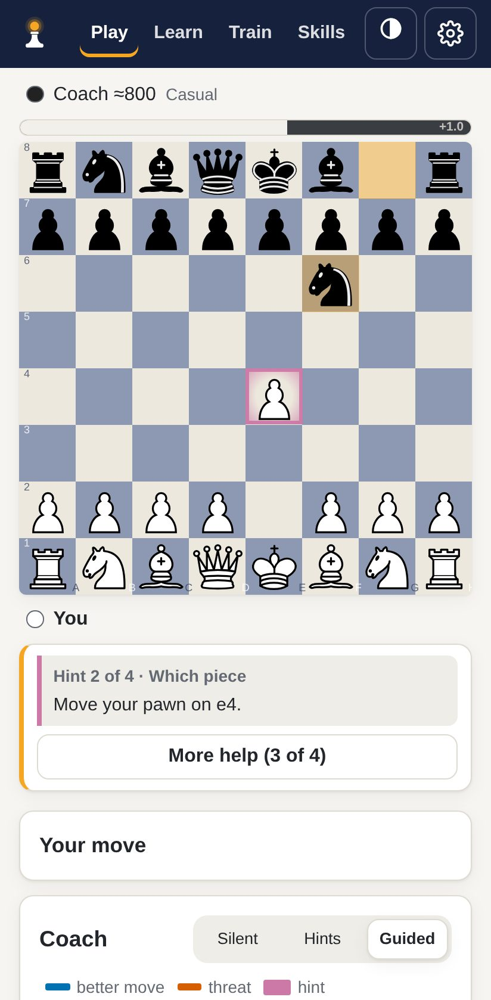
  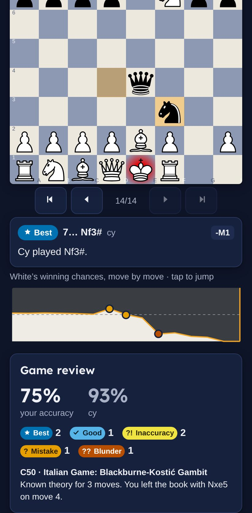
  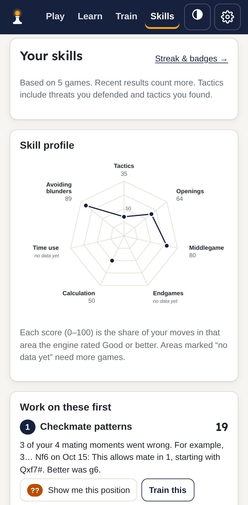
</p>

## What it is

Beacyn Chess is an open-source chess coach for beginners and improving
players who learn best by *seeing*. You play against an engine that adapts to
your level, and the coach explains the game on the board — arrows,
highlighted squares, colored move badges and one or two short sentences.
After the game it finds your weak spots and gives you puzzles, lessons and
drills for them.

Everything the coach says comes from the Stockfish engine and from checks
on the actual board. It never makes up a reason.

## Features

**Play**
- Play White, Black or random against Stockfish, strength ≈400–2500. Beginner
  levels make human-like mistakes, so they can actually be beaten.
- Strength adjusts after each game to keep you near a 50% score.
- Untimed by default, or 5+0, 10+0, 15+10 clocks. Take-backs are allowed
  (logged, never penalised).
- Drag, tap, use the keyboard, or type moves (`e4`, `Nf3`, `O-O`).

**Live coaching**
- Every move gets a badge — Brilliant, Best, Good, Inaccuracy, Mistake,
  Blunder, Missed win — in colorblind-safe colors, always with a symbol.
- Short reasons from verified board checks: hanging pieces, forks, pins,
  skewers, discovered attacks, mate threats, development, king safety, passed
  pawns and more.
- "See it on the board" draws the threat and the better move; "Show me why"
  steps through the engine's line.
- A four-step hint ladder, and Guided mode warns you *before* a blunder.

**Review** — a graph of who was winning (tap to jump), accuracy, move-quality
counts, 3–5 key moments with **Retry this position**, the opening name and
how long you stayed in theory. Import games from elsewhere as PGN.

**Skills** — a radar of seven skills (tactics, openings, middlegame,
endgames, calculation, time use, avoiding blunders), tactics by motif, trends,
and your three weakest areas, each with a real position from your games.

**Train** — a daily plan from your weak spots; 5,000+ puzzles from the free
Lichess database in 9 themes, matched to your rating; your own mistakes as
puzzles; missed puzzles come back on a spaced-repetition schedule.

**Learn** — 16 short lessons with board exercises, an opening trainer
(5 repertoires), 8 endgame drills against the engine, visualization drills,
and a two-minute placement for new players.

**Progress** — a day streak that a single missed day *freezes* instead of
resetting, and badges for real achievements (first win, first checkmate in a
drill, 100 puzzles, a skill reaching 60 or 80…), worked out only from your
saved data.

**Made for everyone**
- Full keyboard play: Tab to the board, arrow keys to choose a square, Enter
  to pick up and put down. Every move is read aloud in words to screen readers
  ("White knight to f3, check"), followed by the coach's note.
- Respects reduced motion; text contrast checked to WCAG AA in both themes.
- Light and dark themes, 4 board colors, 3 piece sets, optional sounds.
- Works on phones; install it to your home screen, and play and puzzles work
  offline.

**Optional AI wording (off by default).** If you like, an AI can reword the
coach's notes in friendlier language: a small model that runs in your
browser (*experimental*; free, ~700 MB one-time download, needs WebGPU), an
[Ollama](https://ollama.com/) server on your own computer, or your own
Anthropic API key (*experimental*; Claude Haiku 5.5 by default, and each
explanation uses your own API credits). The AI only rewords facts the engine and board checks
already confirmed: any reply that mentions a move, square, number or chess
idea that wasn't in the original note is thrown away. The app is complete
without it.

## Screenshots

| | Phone (light) | Phone (dark) | Desktop |
|---|---|---|---|
| Play with coaching |  | 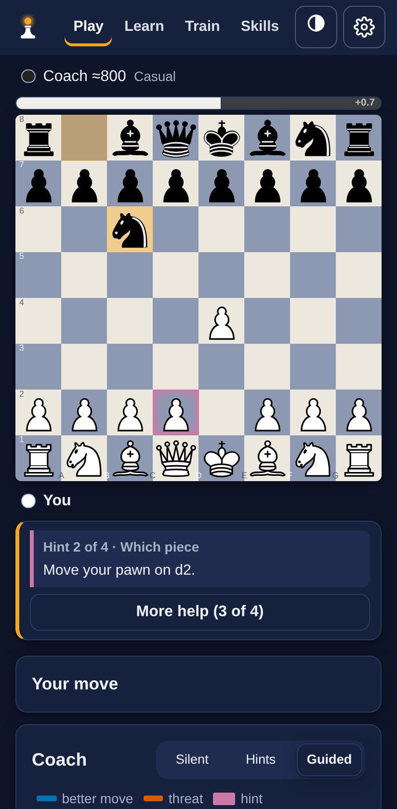 | 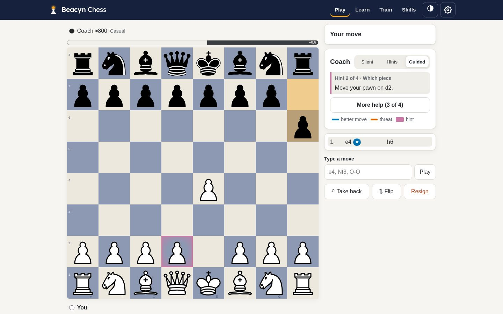 |
| Review | 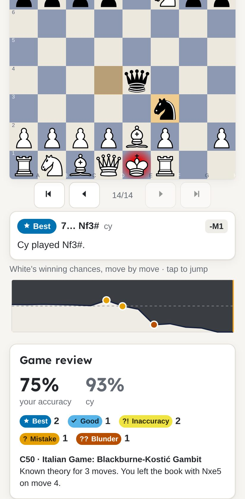 |  | 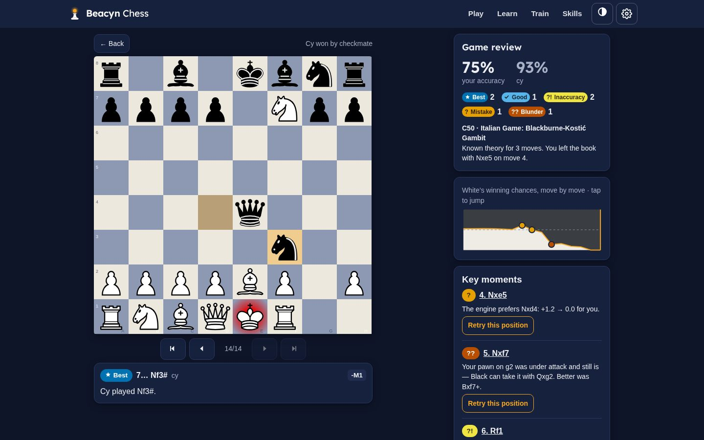 |
| Skills |  | 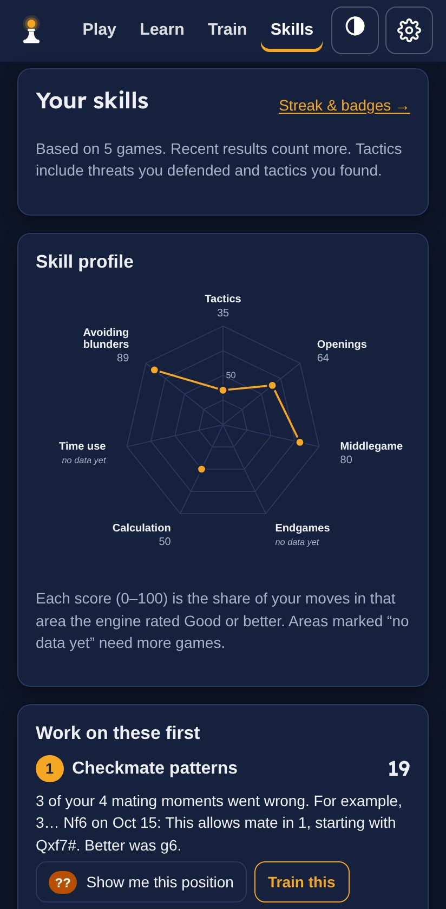 | 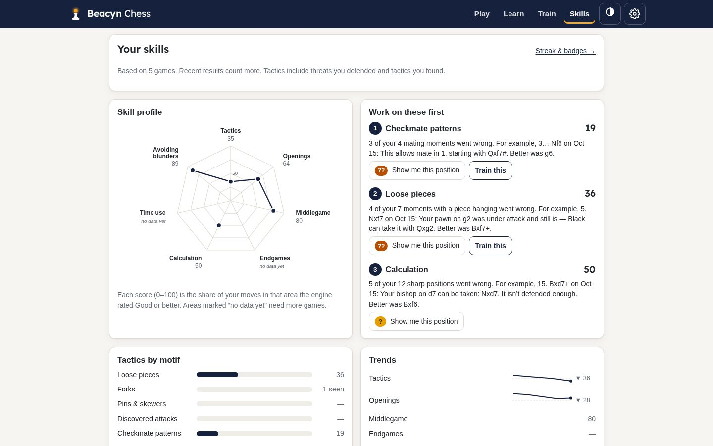 |
| Train | 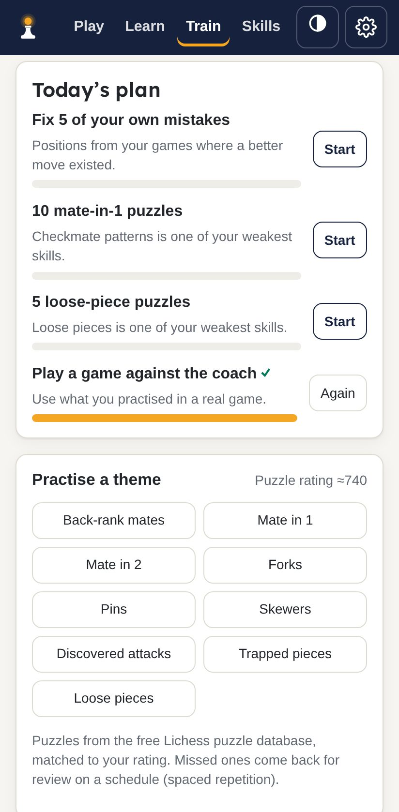 | 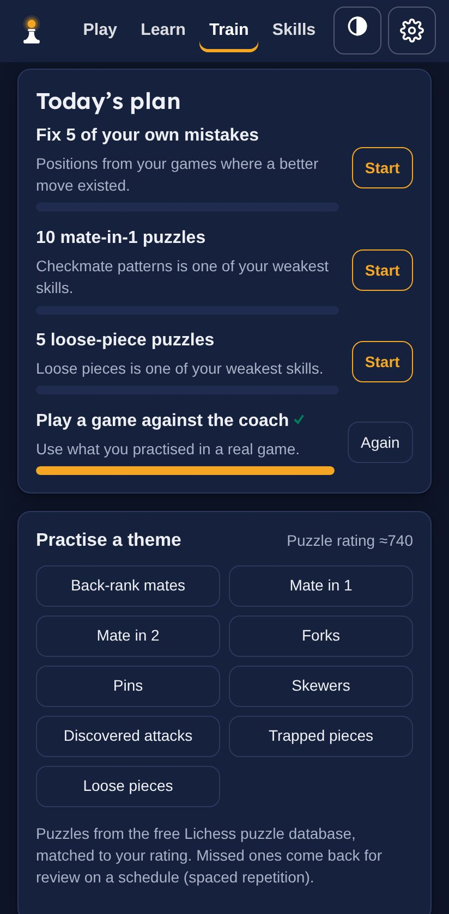 | 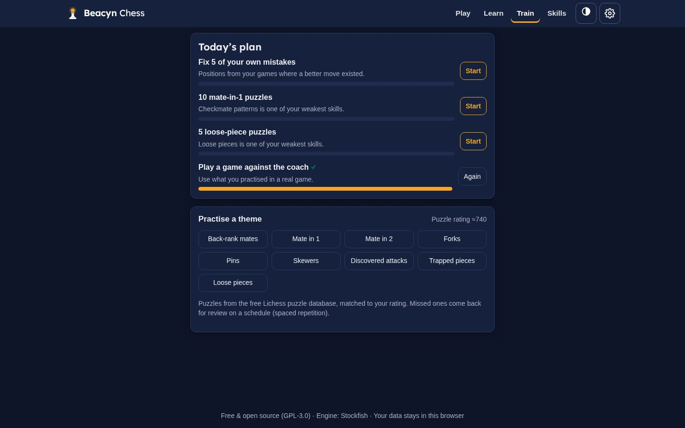 |
| Learn | 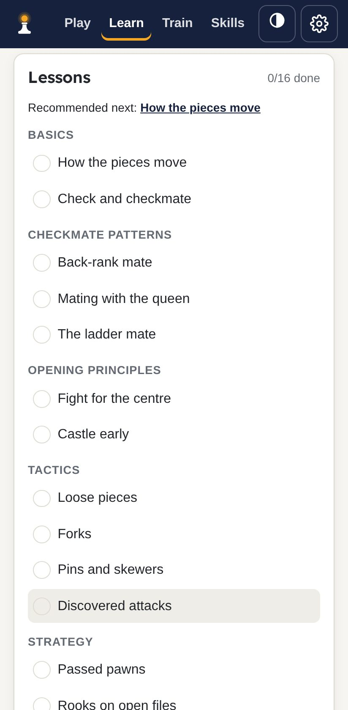 | 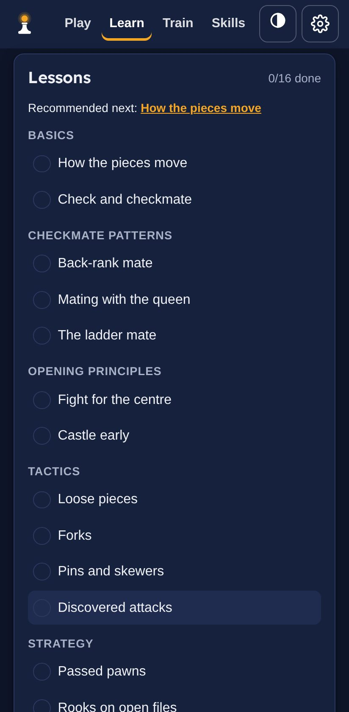 | 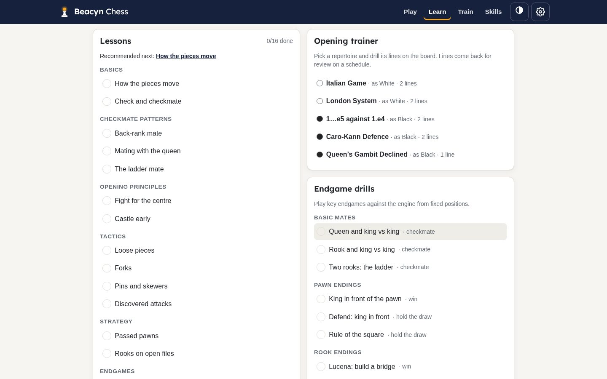 |

All 20 shots (both themes at both sizes) are in [docs/screenshots](docs/screenshots).

## Try it

Open **https://nabdalla-prog.github.io/beacyn-chess/** on any phone, tablet
or computer. Nothing to install — or use your browser's "Install app" /
"Add to Home Screen" to keep it handy and use it offline.

## Run locally

```sh
npm install      # also copies the Stockfish engine into public/engine/
npm run dev      # http://localhost:5173
npm run lint     # oxlint
npm test         # unit tests (Vitest)
npm run e2e      # browser tests (Playwright), incl. axe accessibility checks
```

For `npm run e2e` either run `npx playwright install chromium` once, or use a
system browser: `CHROMIUM_PATH=/usr/bin/chromium npm run e2e`.

To deploy your own copy: fork the repo, then in **Settings → Pages** choose
**GitHub Actions** as the source. Every push to `main` runs the tests and
publishes the site.

## How it works

- **Engine:** Stockfish 19 *lite, single-threaded* WebAssembly in a Web
  Worker — no special server headers needed, so it runs on GitHub Pages. One
  engine plays you (strength-limited, with human-like slips at low levels);
  a second, full-strength one analyses for the coach.
- **Rules and board:** [chess.js](https://github.com/jhlywa/chess.js) owns the
  rules; [chessground](https://github.com/lichess-org/chessground) (the
  Lichess board) draws the board, arrows and highlights.
- **Coaching:** move quality comes from the engine's win-probability drop;
  every named idea (fork, pin, hanging piece…) comes from a detector that
  checks the real position, with unit tests on known positions. If no
  detector fires, the coach only says what the engine says.
- **AI is optional:** see above. It is loaded only if you turn it on, and its
  output is checked against the original facts before you see it.
- **Built with** React, Vite and TypeScript; static files only. See
  [PLAN.md](PLAN.md) for the design and every decision.

## Privacy

- **All your data stays in your browser** (IndexedDB): games, skills, puzzle
  schedule, settings. There is no server, no account, no analytics, no
  tracking and no cookies.
- **Export / import** your data as one JSON file from Settings, to back it up
  or move it to another device.
- **Optional AI:** off by default. The in-browser model runs on your device.
  With Ollama, notes go only to the server address you enter. With your own
  key, the key is stored only in this browser and notes are sent only to
  Anthropic; the key is never included in backups, and "Forget key" deletes
  it.

## Credits and licenses

Beacyn Chess is built on these open projects. Thank you to their authors.

| Project | Used for | License |
|---|---|---|
| [Stockfish](https://stockfishchess.org/) via [stockfish.js](https://github.com/nmrugg/stockfish.js) by Nathan Rugg and the Stockfish developers | Chess engine (WebAssembly) | GPL-3.0 |
| [chessground](https://github.com/lichess-org/chessground) by the Lichess team | Board, arrows, highlights | GPL-3.0-or-later |
| [chess.js](https://github.com/jhlywa/chess.js) by Jeff Hlywa | Rules, PGN, FEN | BSD-2-Clause |
| [React](https://react.dev/) | User interface | MIT |
| [idb](https://github.com/jakearchibald/idb) by Jake Archibald | IndexedDB storage | ISC |
| [chess-openings](https://github.com/lichess-org/chess-openings) by the Lichess team | Opening names and ECO codes | CC0 |
| [Lichess puzzle database](https://database.lichess.org/#puzzles) | Training puzzles (curated subset) | CC0 |
| [WebLLM](https://github.com/mlc-ai/web-llm) by the MLC team | Optional in-browser AI (loaded only if chosen) | Apache-2.0 |
| [Anthropic TypeScript SDK](https://github.com/anthropics/anthropic-sdk-typescript) | Optional "own key" AI (loaded only if chosen) | MIT |
| [axe-core](https://github.com/dequelabs/axe-core) (tests only) | Automated accessibility checks | MPL-2.0 |

**Assets**

| Asset | Author | License |
|---|---|---|
| Pieces: *Classic* (cburnett), bundled with chessground | Colin M.L. Burnett | GPLv2+ |
| Pieces: *Merida* (from [lila](https://github.com/lichess-org/lila)) | Armando Hernandez Marroquin | GPLv2+ |
| Pieces: *Chessnut* ([chessnut-pieces](https://github.com/LexLuengas/chessnut-pieces)) | Alexis Luengas | Apache-2.0 ([license](public/pieces/chessnut/LICENSE.txt)) |
| Sounds: [Impact Sounds](https://kenney.nl/assets/impact-sounds) and [Interface Sounds](https://kenney.nl/assets/interface-sounds), trimmed by `scripts/build-sounds.sh` | Kenney | CC0 |
| Font: [Lexend](https://www.lexend.com/) via [Fontsource](https://fontsource.org/) | The Lexend Project | SIL OFL 1.1 |
| Optional in-browser model: [Llama 3.2 1B Instruct](https://huggingface.co/mlc-ai/Llama-3.2-1B-Instruct-q4f16_1-MLC) (MLC build), downloaded by your browser from Hugging Face only if you choose it — not part of this repository | Meta | Llama 3.2 Community License |

The game in the screenshots is Morphy's "Opera Game" (1858, public domain).

**This project:** GPL-3.0-or-later — see [LICENSE](LICENSE). Because
Stockfish and chessground are GPL, any copy or fork you distribute must also
be GPL and share its source code.

## Contributing

Bug reports, ideas and pull requests are welcome — see
[CONTRIBUTING.md](CONTRIBUTING.md). To report a security problem privately,
see [SECURITY.md](SECURITY.md).
